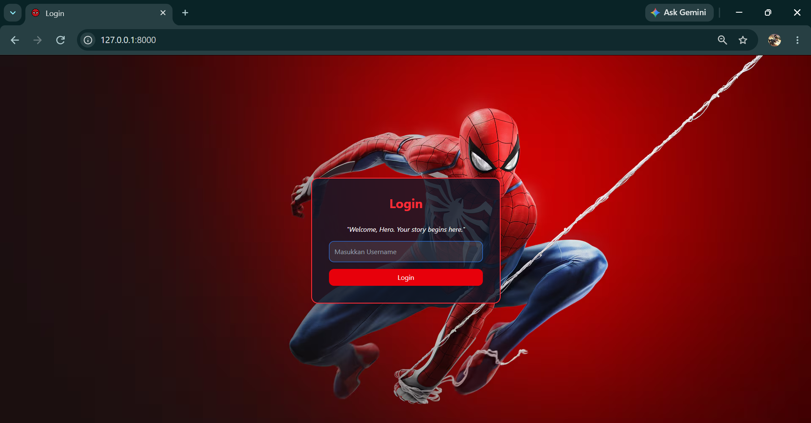
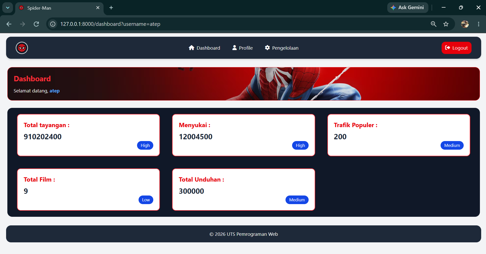
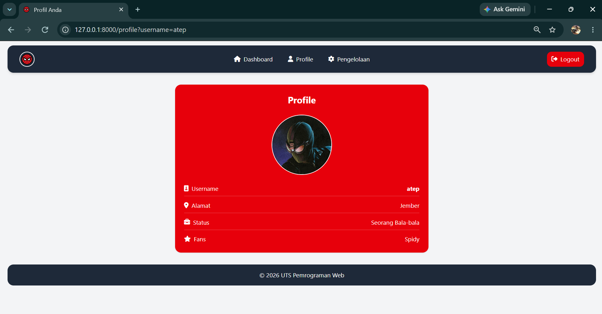
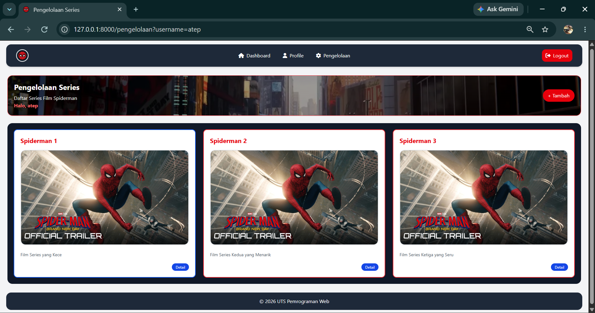

## Pengelolaan Film Spiderman
### Gambar Website :
<h2>Login</h2>

<h2>Dashboard</h2>

<h2>Profil</h2>

<h2>Pengelolaan</h2>

### Deskripsi :

Saya M. Nadiv Darmawan dari NIM 252410102024, yang saat ini membuat project UTS PWEB A dengan tema Pengelolaan Film Spider-Man menggunakan Laravel dan menerapkan alur penggunaan Controller.

Disini dimulai dari fitur login yang berisi input username dan validasi error jika username tidak diinputkan. Halaman login juga menggunakan background bertema Spider-Man yang berasal dari asset gambar pada folder public/images.

Selanjutnya terdapat dashboard yang menampilkan informasi statistik seputar dunia Spider-Man serta username yang diinputkan saat login. Data dashboard disimpan dalam bentuk array pada PageController, dengan isi sebagai berikut :
<ol>
    <li>Total Tayangan</li>
    <li>Menyukai</li>
    <li>Trafik Populer</li>
    <li>Total Film</li>
    <li>Total Unduhan</li>
</ol>
Untuk datanya disini disimpan dalam array di PageController.

 
Setelah itu terdapat halaman Profil yang menampilkan username pengguna serta informasi profil penggemar Spider-Man yang disimpan dalam bentuk array, yaitu :
<ol>
    <li>alamat</li>
    <li>status</li>
    <li>fans</li>
</ol>

Lalu ada pengelolaan disini adalah isi dari series film yang ditambahkan dan juga get data username dari login isi dari pengelolaan :
<ol>
    <li>Judul</li>
    <li>Deskripsi</li>
</ol>

Lalu terdapat halaman Pengelolaan yang menampilkan daftar series film Spider-Man beserta informasi judul dan deskripsi dari setiap film. Data series ditampilkan melalui array yang dikelola pada Controller.

Terakhir, terdapat fitur Logout yang digunakan untuk mengakhiri sesi pengguna. Setelah logout, username dan sesi login akan direset sehingga pengguna dapat kembali ke halaman login.

